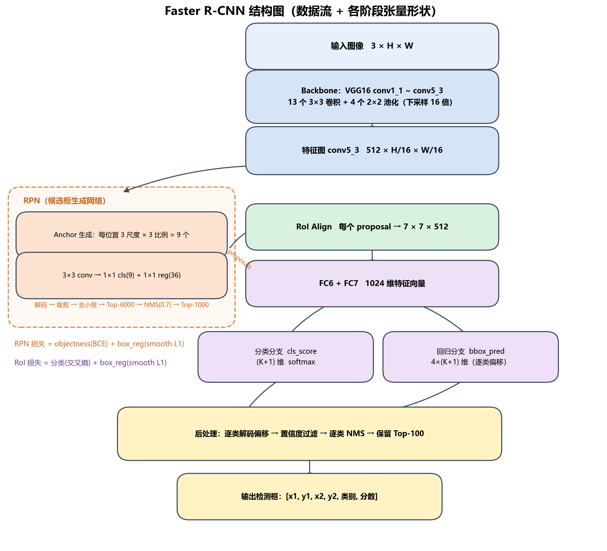
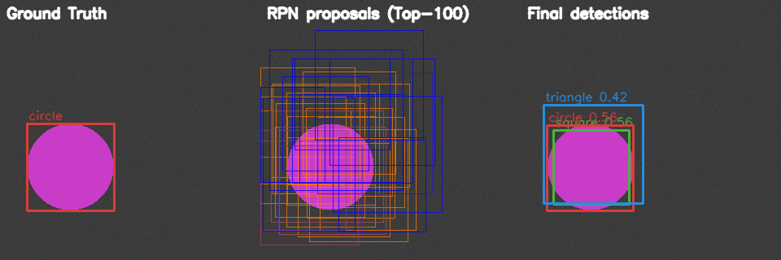
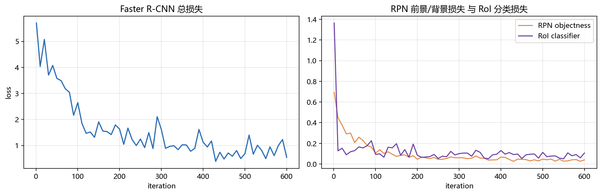
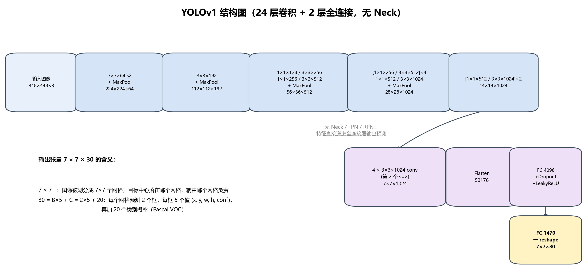
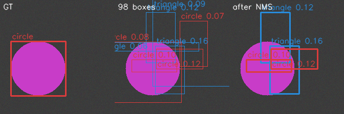
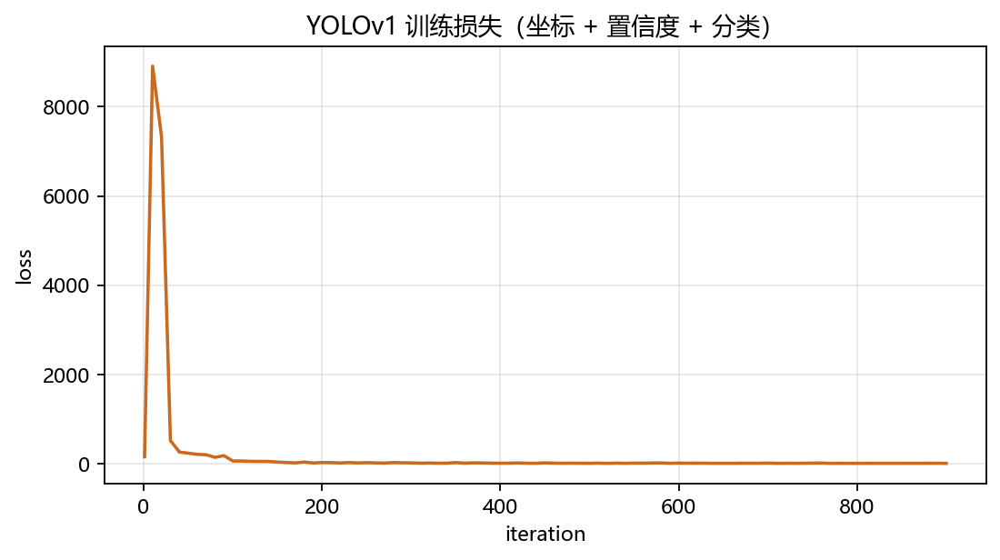
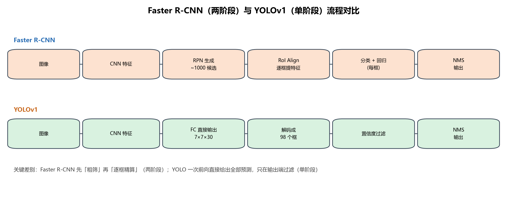

# 实验三：目标检测（Faster R-CNN 与 YOLO 源码分析及跑通）

> **实验环境**
> - 操作系统：Windows 11，Python 3.13.9
> - 深度学习框架：PyTorch 2.14.0+cpu / torchvision 0.29.0+cpu（无 GPU，全部实验在 CPU 上完成）
> - 其它：NumPy 2.3.5、OpenCV 4.13.0、Matplotlib 3.10.8
> - 参考开源仓库：<https://github.com/RickyPyeet/yolov1-pytorch>（任务 B 的 YOLOv1 源码分析对象）
>
> **本项目代码位置**：`D:\桌面\Target Detection\`
>
> ```text
> Target Detection/
> ├── faster_rcnn/           # 任务 A：Faster R-CNN 从零实现（逐段注释，可运行）
> │   ├── backbone.py        #   VGG16 主干
> │   ├── anchors.py         #   Anchor 生成
> │   ├── rpn.py             #   RPN + Proposal 筛选
> │   ├── roi_heads.py       #   RoI Align + FC6/FC7 + 双分支检测头
> │   ├── box_utils.py       #   框编解码（框回归的数学核心）
> │   ├── nms.py             #   NMS / Soft-NMS
> │   └── model.py           #   整体组装 + 数据流追踪
> ├── yolov1/                # 任务 B.1：YOLOv1（对齐参考仓库结构）
> │   ├── backbone.py        #   24 层卷积主干
> │   ├── head.py            #   YOLOv1DetectionBlock（FC4096 → FC1470）
> │   ├── loss.py            #   YOLOv1 Loss（坐标/置信度/分类）
> │   ├── postprocess.py     #   解码 + 置信度过滤 + NMS
> │   └── model.py
> ├── yolov5/                # 任务 B.2：YOLOv5 改进点的可运行对照实现
> │   ├── modules.py         #   Conv/C3/SPPF/Focus/Detect/PANet
> │   ├── loss.py            #   CIoU + 目标分配
> │   ├── anchors.py         #   AutoAnchor（k-means + BPR）
> │   └── augment.py         #   Mosaic / letterbox
> ├── demo/                  # 跑通脚本
> │   ├── dataset.py         #   合成数据集（圆/方/三角）
> │   ├── train_demo.py      #   训练两个检测器
> │   ├── run_faster_rcnn.py #   推理 + 数据流追踪 + 可视化
> │   ├── run_yolov1.py      #   推理 + 解码/NMS 可视化
> │   ├── compare_speed.py   #   任务 C 的推理耗时实测
> │   └── run_yolo26.py      #   选做：YOLO26 推理
> ├── figures/               # 结构图
> ├── weights/               # 训练好的权重
> └── outputs/               # 推理可视化结果
> ```

---

# 一、实验目标

1. 理解 Faster R-CNN 与 YOLO 的整体架构及检测流程。
2. 能够根据算法的数据流定位核心源码，而不是仅停留在论文和概念层面。
3. 跑通目标检测任务。

**完成情况**

| 目标 | 完成情况 |
| --- | --- |
| 架构与流程 | 手绘/程序化生成 Faster R-CNN 与 YOLOv1 结构图，标注每阶段张量形状 |
| 定位源码 | 从"输入张量 → 输出张量"逐层追踪，给出每个环节的**文件 + 函数 + 代码片段**；`demo/run_faster_rcnn.py` 会打印全部中间张量形状 |
| 跑通 | 两个检测器均在自建合成数据集上完成训练（损失下降）与推理（框落在目标上），并生成可视化；另实测推理耗时、跑通 YOLO26 推理脚本 |

---

# 二、实验内容

## 任务 A：Faster R-CNN 源码分析

### 1. 代码架构

Faster R-CNN 的代码是"一条主干 + 一个分支"的结构，我按**数据流**把它拆成 7 个文件，每个文件只负责一个环节，函数名与论文术语一一对应：

```text
输入图像 (3, H, W)
   │
   ├─[model.py  GeneralTransform]── 归一化(ImageNet均值方差) + 短边缩放到 min_size
   │
   ├─[backbone.py  VGG16Backbone]── conv1_1 … conv5_3
   │        └─> 特征图 features["0"] : (1, 512, H/16, W/16)
   │
   ├─[anchors.py  AnchorGenerator]── 在 H/16 × W/16 的每个位置铺 9 个 anchor
   │        └─> anchors : (H/16 · W/16 · 9, 4)
   │
   ├─[rpn.py  RPN]───────────────── RPNHead(3×3 conv → 1×1 cls / 1×1 reg)
   │        ├─ 训练：assign_targets_to_anchors → sample_anchors → _compute_loss
   │        └─ 推理：BoxCoder.decode → filter_proposals(Top-N → NMS → Top-N)
   │                 └─> proposals : (≤1000, 5)  [x1,y1,x2,y2,score]
   │
   ├─[roi_heads.py  RoIAlign]─────── 每个 proposal 抠成 7×7×512
   │
   ├─[roi_heads.py  TwoMLPHead]───── flatten(25088) → FC6(1024) → FC7(1024)
   │
   ├─[roi_heads.py  FastRCNNPredictor]
   │        ├─ cls_score : (P, K+1)      softmax → 类别
   │        └─ bbox_pred : (P, 4(K+1))   逐类偏移
   │
   └─[roi_heads.py  postprocess_detections]
            逐类解码 → 置信度过滤(0.05) → 逐类 NMS(0.5) → Top-100 → 输出
```

各文件职责：

| 文件 | 核心类 / 函数 | 论文对应 |
| --- | --- | --- |
| `faster_rcnn/backbone.py` | `VGG16Backbone` | 共享卷积层（conv1~conv5_3） |
| `faster_rcnn/anchors.py` | `AnchorGenerator._generate_cell_anchors / _grid_anchors` | Anchor 生成 |
| `faster_rcnn/rpn.py` | `RPNHead`、`assign_targets_to_anchors`、`RPN.filter_proposals` | RPN |
| `faster_rcnn/roi_heads.py` | `RoIAlign`、`TwoMLPHead`、`FastRCNNPredictor`、`RoIHeads.postprocess_detections` | RoI Pooling/Align + 检测头 |
| `faster_rcnn/box_utils.py` | `BoxCoder.encode / decode` | 边界框回归的参数化 |
| `faster_rcnn/nms.py` | `nms / batched_nms` | NMS |
| `faster_rcnn/model.py` | `FasterRCNN`、`build_faster_rcnn` | 整体组装 |

**数据流实测**（`python demo/run_faster_rcnn.py` 打印，输入 320×320，LightBackbone）：

```text
input                             (3, 320, 320)
backbone/s1                       (1, 32, 160, 160)
backbone/s2                       (1, 64, 80, 80)
backbone/s3                       (1, 128, 40, 40)
backbone/s4                       (1, 256, 20, 20)
conv5_3                           (1, 256, 20, 20)
rpn/anchors                       (3600, 4)        # 20×20×9
rpn/objectness_map                (1, 9, 20, 20)
rpn/bbox_pred_map                 (1, 36, 20, 20)
rpn/proposals(after filter)       (35, 5)
roi_align/features                (35, 256, 7, 7)
roi_heads/fc7                     (35, 1024)
roi_heads/cls_score               (35, 4)
roi_heads/bbox_pred               (35, 16)
final/detections                  (≤100, 4)
```

> 换成论文配置（VGG16，800×1333）时，conv5_3 为 `(1, 512, 50, 84)`，anchor 数约 3.8 万，
> proposal 固定压到 1000 个 —— 这就是"为什么必须有 RPN 做筛选"的最直观答案。

### 2. Faster R-CNN 结构图



四个阶段（对应上面代码架构的四段）：

1. **特征提取**：VGG16 到 conv5_3，得到 stride=16 的 512 通道特征图。丢弃 fc6/fc7 是因为全连接层会破坏空间结构，而 RPN 需要"逐位置"预测。
2. **候选框生成（RPN）**：在特征图每个位置铺 9 个 anchor，用 3×3 卷积提取一个 512 维特征，再用两条 1×1 卷积分支分别输出"前景分数（9 维）"和"框偏移（36 维）"。解码后经 Top-N → NMS → Top-N 压缩到约 1000 个 proposal。
3. **特征对齐（RoI Align）**：把每个 proposal 在特征图上抠成固定 7×7×512，供后续全连接层使用（全连接要求固定尺寸输入）。
4. **分类回归（RoI Heads）**：FC6/FC7 → 分类分支（K+1 类）+ 回归分支（4(K+1) 维，逐类偏移）→ 后处理输出最终框。

**两阶段的关键点**：RPN 与 RoI Heads **共享同一份 conv5_3 特征**，因此整个网络可以端到端联合训练，总损失为四项之和：

```text
L = L_rpn_cls + L_rpn_reg + L_roi_cls + L_roi_reg
```

### 3. Backbone、RPN、RoI Heads 源码分析

#### （1）Backbone：`faster_rcnn/backbone.py` · `VGG16Backbone`

```python
class VGG16Backbone(nn.Module):
    """VGG16 主干，输出 conv5_3（512 通道，stride 16）"""

    # VGG16 的卷积配置，'M' 表示 MaxPool
    CFG = [64, 64, "M", 128, 128, "M", 256, 256, 256, "M",
           512, 512, 512, "M", 512, 512, 512]

    def __init__(self, pretrained: bool = False):
        super().__init__()
        self.out_channels = 512
        self.features = self._make_layers(self.CFG)
        # 5 个 stage 的结束位置，用于数据流追踪
        self.stage_ends = [4, 9, 16, 23, len(self.features)]

    def forward(self, x: Tensor) -> Dict[str, Tensor]:
        return OrderedDict([("0", self.features(x))])
```

**解释**

- `CFG` 里 13 个整数是 13 个 3×3 卷积，4 个 `"M"` 是 4 次 2×2 池化 → 总下采样 **16 倍**。所以 800×1333 的输入得到 50×84 的特征图。
- 输出用 `OrderedDict` 而不是裸 Tensor，是为了和 FPN（多层特征）的接口保持一致；本实验只有 `"0"` 一层。
- `out_channels=512` 会被 `RPN` 和 `RoIHeads` 用作 `in_channels`，保证三个模块"咬合"。
- `forward_intermediates()` 逐 stage 返回特征图，用于验证 `conv1_2 → conv2_2 → conv3_3 → conv4_3 → conv5_3` 的尺寸变化（这也是报告里"数据流追踪"表格的来源）。

> 为了在 CPU 上能真正训练，另实现了 `LightBackbone`：结构与 VGG16 同构（3×3 卷积堆叠 + 池化），只是通道数缩减为 32/64/128/256。这样"数据流、损失、优化"完全一致，只是算力需求降到 1/20。

#### （2）RPN：`faster_rcnn/rpn.py` · `RPNHead` + `RPN.forward`

```python
class RPNHead(nn.Module):
    def __init__(self, in_channels: int = 512, num_anchors: int = 9):
        super().__init__()
        self.conv = nn.Conv2d(in_channels, in_channels, kernel_size=3, padding=1)
        self.cls_logits = nn.Conv2d(in_channels, num_anchors, kernel_size=1)      # 9 通道
        self.bbox_pred = nn.Conv2d(in_channels, num_anchors * 4, kernel_size=1)   # 36 通道

    def forward(self, features: List[Tensor]) -> Tuple[List[Tensor], List[Tensor]]:
        logits, bbox_reg = [], []
        for f in features:
            t = F.relu(self.conv(f))
            logits.append(self.cls_logits(t))     # (N, A, H, W)
            bbox_reg.append(self.bbox_pred(t))    # (N, A*4, H, W)
        return logits, bbox_reg
```

**解释**

- RPN 头只有 3 层卷积，**完全卷积化**：输入多大输出就多大，因此可以吃任意尺寸的图像（这也是 Faster R-CNN 相比 Fast R-CNN 的工程优势之一）。
- `cls_logits` 的通道数 = anchor 数（9），每个通道对应一种 anchor 的"前景 logit"；`bbox_pred` 的通道数 = 9×4，对应每个 anchor 的 4 个偏移。
- 注意这里用 **sigmoid 二分类**（不是 softmax），因为"前景/背景"是独立判断，不是互斥多类。

```python
    def forward(self, images, features, targets=None):
        feature_list = list(features.values())
        objectness, pred_bbox_deltas = self.head(feature_list)     # [(N,A,H,W)], [(N,A*4,H,W)]
        anchors = self.anchor_generator(feature_list, images.image_sizes)

        # ---- 训练分支：计算 RPN 损失 ----
        losses = {}
        if self.training and targets is not None:
            labels, matched_gt_boxes = assign_targets_to_anchors(
                anchors, targets, self.fg_iou_thresh, self.bg_iou_thresh)
            sampled_idxs = sample_anchors(labels, self.batch_size_per_image, self.positive_fraction)
            losses = self._compute_loss(objectness, pred_bbox_deltas, anchors,
                                        labels, matched_gt_boxes, sampled_idxs)

        # ---- 推理分支：解码 + 筛选，得到 proposal ----
        num_images = len(anchors)
        objectness = self._cat_levels(objectness)              # (N, num_anchors)
        pred_bbox_deltas = self._cat_levels(pred_bbox_deltas)  # (N, num_anchors*4)

        proposals = []
        for i in range(num_images):
            boxes = self.box_coder.decode(pred_bbox_deltas[i], anchors[i])   # 解码
            boxes = boxes.view(-1, 4)
            scores = objectness[i]
            boxes, scores = self.filter_proposals(boxes, scores, images.image_sizes[i])
            proposals.append(torch.cat([boxes, scores[:, None]], dim=1))     # (P, 5)
        return proposals, losses
```

**解释**

- **训练与推理走两条不同的路**：训练要"采样 + 算损失"，推理要"解码 + 筛选"。这是两阶段检测器的典型写法（Faster R-CNN 之后的 RPN 实现几乎都是这个骨架）。
- `_cat_levels` 里最关键的是 **`permute(0, 2, 3, 1)`**：

```python
    @staticmethod
    def _flatten(x: List[Tensor]) -> List[Tensor]:
        out = []
        for t in x:
            t = t.permute(0, 2, 3, 1).reshape(t.shape[0], -1)   # (N,A,H,W) -> (N,H,W,A)
            out.append(t)
        return out
```

卷积输出是 `(N, A, H, W)`，而 anchor 的生成顺序是"先 y、再 x、最后 anchor 模板"（`(H, W, A, 4)` 展平成 `(H·W·A, 4)`）。必须先 permute 成 `(N, H, W, A)` 再 reshape，第 k 个预测才与第 k 个 anchor 严格对应。**这一步写错，网络依然能跑、损失也会下降，但永远学不好** —— 是 RPN 最容易踩的坑。

#### （3）RoI Heads：`faster_rcnn/roi_heads.py` · `RoIAlign` + `TwoMLPHead` + `FastRCNNPredictor`

```python
class RoIAlign(nn.Module):
    def forward(self, features: Dict[str, Tensor], boxes: List[Tensor]) -> Tensor:
        feats = list(features.values())
        # 把每张图的框加上 batch 索引，拼成一个 (sum(P), 5) 的张量
        rois = []
        for img_id, boxes_per_image in enumerate(boxes):
            idx = torch.full((boxes_per_image.shape[0], 1), img_id,
                             dtype=boxes_per_image.dtype, device=boxes_per_image.device)
            rois.append(torch.cat([idx, boxes_per_image], dim=1))
        rois = torch.cat(rois, dim=0)
        return tv_roi_align(feats[0], rois, output_size=self.output_size,
                            spatial_scale=self.spatial_scale,
                            sampling_ratio=self.sampling_ratio, aligned=True)


class TwoMLPHead(nn.Module):
    """7x7x512 -> flatten(25088) -> fc6(1024) -> fc7(1024)"""
    def __init__(self, in_channels: int = 512, representation_size: int = 1024):
        super().__init__()
        self.fc6 = nn.Linear(in_channels * 7 * 7, representation_size)
        self.fc7 = nn.Linear(representation_size, representation_size)

    def forward(self, x: Tensor) -> Tensor:
        x = x.flatten(start_dim=1)          # (N, 25088)
        x = F.relu(self.fc6(x))
        x = F.relu(self.fc7(x))
        return x


class FastRCNNPredictor(nn.Module):
    def __init__(self, in_channels: int = 1024, num_classes: int = 21):
        super().__init__()
        self.cls_score = nn.Linear(in_channels, num_classes)        # K+1
        self.bbox_pred = nn.Linear(in_channels, num_classes * 4)    # 4(K+1)
```

**解释**

- `rois` 的第 0 列是 **batch 索引**，这是 `roi_align` 算子的约定：一次调用就能处理整个 batch 的所有 RoI，不用 for 循环。
- `spatial_scale=1/16` 把原图坐标换算到特征图坐标（因为 conv5_3 下采样了 16 倍）。
- `bbox_pred` 输出 **4×(K+1)** 而不是 4，意味着每个类别都有自己的一套偏移（class-specific regression）。推理时只取"预测类别"那 4 个值；训练时只对正样本、只对真实类别的 4 个值算损失。
- 7×7×512 = 25088 → FC6 有 25088×1024 ≈ 25.7M 参数，是 RoI Heads 里最大的一块。

RoI Heads 的前向（训练/推理分叉）：

```python
    def forward(self, features, proposals, image_sizes, targets=None):
        boxes = [p[:, :4] for p in proposals]

        # ---- 训练：先采样 512 个 proposal（正样本 25%），再提特征 ----
        losses = {}
        if self.training and targets is not None:
            labels, matched_gt_boxes, sampled_idxs = self._sample_proposals(
                proposals, targets, image_sizes)
            boxes = [boxes[i][sampled_idxs[i]] for i in range(len(boxes))]

        # ---- RoI 特征提取：这是 RPN 与检测头之间唯一的"接口" ----
        box_features = self.box_roi_pool(features, boxes)        # (sum(P), 512, 7, 7)
        box_features = self.box_head(box_features)               # (sum(P), 1024)
        class_logits, box_regression = self.box_predictor(box_features)

        if self.training and targets is not None:
            losses = self._compute_loss(class_logits, box_regression, boxes, labels, matched_gt_boxes)
            return [], losses

        # ---- 推理：逐类解码 + 后处理 ----
        ...
        detections = [self.postprocess_detections(lg, rg, bx, size) for ...]
        return detections, losses
```

### 4. Anchor 生成 / Proposal 筛选 / NMS / RoI 特征提取 / 最终框回归

#### （1）Anchor 生成 —— `faster_rcnn/anchors.py`

```python
    @staticmethod
    def _generate_cell_anchors(sizes, aspect_ratios) -> Tensor:
        cell_anchors = []
        for size in sizes:
            area = size ** 2                       # 尺度按"面积"定义
            for ratio in aspect_ratios:
                # 由 w*h = area, w/h = ratio 解出 w、h
                w = math.sqrt(area / ratio)
                h = w * ratio
                cell_anchors.append([-w / 2, -h / 2, w / 2, h / 2])
        return torch.as_tensor(cell_anchors, dtype=torch.float32)   # (A, 4)

    def _grid_anchors(self, grid_sizes, strides):
        for size, stride, base in zip(grid_sizes, strides, self.cell_anchors):
            # 每个格点中心在"原图坐标系"下的 x / y
            shifts_x = torch.arange(0, grid_width) * stride_width
            shifts_y = torch.arange(0, grid_height) * stride_height
            shift_y, shift_x = torch.meshgrid(shifts_y, shifts_x, indexing="ij")
            shifts = torch.stack((shift_x, shift_y, shift_x, shift_y), dim=1)
            # (H*W, 1, 4) + (1, A, 4) -> (H*W, A, 4) -> (H*W*A, 4)
            anchors.append((shifts.view(-1, 1, 4) + base.view(1, -1, 4)).reshape(-1, 4))
```

**解释**

- 先解方程得到 9 个"以原点为中心"的模板（3 个面积 × 3 个长宽比），再平移到每个格点。这种"模板 + 平移"的写法避免了对每个 anchor 单独计算，且天然可缓存。
- 为什么用 `(w, h)` 而不是 `(x1, y1, x2, y2)` 存模板？因为"面积 + 比例"是论文的超参定义方式，可读性更好。
- **尺度必须与数据匹配**：论文用 128/256/512 是因为 COCO 目标较大。本实验的合成目标只有 40~110 px，我改成了 32/64/128（见第四节踩坑 #7），否则正样本几乎为零、RPN 根本学不动。

实测不同 IoU 阈值下的正样本数量（320×320，anchor = 64/96/128 × 比例 0.5/1/2，共 3600 个）：

| 图像 | GT 数 | IoU > 0.7 | IoU > 0.6 | IoU > 0.5 | IoU > 0.4 |
| --- | --- | --- | --- | --- | --- |
| seed=1 | 1 | 1 | 10 | 46 | 110 |
| seed=5 | 1 | 2 | 4 | 28 | 95 |
| seed=9 | 1 | 3 | 4 | 27 | 103 |
| seed=1001 | 1 | 2 | 11 | 52 | 105 |

这张表解释了很多"训练不动"的现象：当阈值取论文的 0.7 时，一张图只有 1~3 个正样本，而每轮采样 256 个 anchor（绝大多数是负样本），模型只要把所有权重压到"全背景"就能把损失降到很低——**这就是正负样本极度不平衡导致的坍缩**。

#### （2）Proposal 筛选 —— `faster_rcnn/rpn.py` · `filter_proposals`

```python
    def filter_proposals(self, boxes, scores, image_size):
        """
        五步流水线：
            1. 裁剪到图像内
            2. 删除过小的框
            3. 按前景分数取 Top-N（pre-NMS，默认 6000）
            4. NMS（IoU 0.7）去掉高度重叠的重复框
            5. 再取 Top-N（post-NMS，默认 1000）交给 RoI Heads
        """
        boxes = clip_boxes_to_image(boxes, image_size)                 # 1
        keep = remove_small_boxes(boxes, self.min_size)                 # 2
        boxes, scores = boxes[keep], scores[keep]

        top_n = self.pre_nms_top_n["training" if self.training else "testing"]
        if top_n > 0 and scores.numel() > top_n:                       # 3
            scores, topk_idx = scores.topk(top_n, sorted=False)
            boxes = boxes[topk_idx]

        keep = nms(boxes, scores, self.nms_thresh)                     # 4
        boxes, scores = boxes[keep], scores[keep]

        post_n = self.post_nms_top_n["training" if self.training else "testing"]
        if post_n > 0 and scores.numel() > post_n:                     # 5
            scores, topk_idx = scores.topk(post_n, sorted=False)
            boxes = boxes[topk_idx]
        return boxes, scores
```

**解释**

- 顺序不能颠倒：**先 Top-N 再 NMS**，因为 NMS 的复杂度是 O(N²)，对 3.8 万个 anchor 直接做 NMS 会非常慢；先砍到 6000 再 NMS，计算量下降 40 倍。
- 训练时用 12000/2000，测试时用 6000/1000：训练阶段保留更多 proposal 以提供更丰富的正样本，测试阶段只要够用就行。
- `remove_small_boxes` 去掉宽或高 < 1 px 的框（裁剪后贴边的退化框）。

#### （3）NMS —— `faster_rcnn/nms.py`

```python
def nms(boxes: Tensor, scores: Tensor, iou_threshold: float) -> Tensor:
    if boxes.numel() == 0:
        return torch.empty((0,), dtype=torch.long, device=boxes.device)

    order = scores.argsort(descending=True)      # 按得分降序
    keep = []
    while order.numel() > 0:
        i = order[0]                             # 当前得分最高的框
        keep.append(i)
        if order.numel() == 1:
            break
        rest = order[1:]
        xx1 = torch.maximum(x1[i], x1[rest])
        yy1 = torch.maximum(y1[i], y1[rest])
        xx2 = torch.minimum(x2[i], x2[rest])
        yy2 = torch.minimum(y2[i], y2[rest])
        inter = (xx2 - xx1).clamp(min=0) * (yy2 - yy1).clamp(min=0)
        iou = inter / (areas[i] + areas[rest] - inter).clamp(min=1e-6)
        order = rest[iou <= iou_threshold]       # 只保留 IoU 小于阈值的框
    return torch.stack(keep)
```

**解释**：贪心策略，每次取当前最高分框，删掉与它 IoU 超阈值的框。多类别时用 `batched_nms`：给不同类别的框坐标加上巨大的偏移，让它们"空间上永不相交"，从而一次调用完成逐类 NMS，避免 O(K) 次 Python 循环：

```python
def batched_nms(boxes, scores, idxs, iou_threshold):
    max_coordinate = boxes.max()
    offsets = idxs.to(boxes.dtype) * (max_coordinate + torch.tensor(1.0))
    boxes_for_nms = boxes + offsets[:, None]
    return nms(boxes_for_nms, scores, iou_threshold)
```

#### （4）RoI 特征提取 —— `faster_rcnn/roi_heads.py` · `RoIAlign`

生产代码直接调用 `torchvision.ops.roi_align`（与 Detectron 数值一致），同时我写了一个**纯 PyTorch 的教学版**，方便看清"双线性插值"到底在做什么：

```python
def roi_align_reference(feature, box, output_size=7, spatial_scale=1/16, sampling_ratio=2):
    C, H, W = feature.shape
    # 1) 把原图坐标换算到特征图坐标（除以 stride）
    x1, y1, x2, y2 = (box * spatial_scale).tolist()
    roi_w, roi_h = x2 - x1, y2 - y1
    bin_w, bin_h = roi_w / output_size, roi_h / output_size

    out = torch.zeros(C, output_size, output_size, device=feature.device)
    for i in range(output_size):
        for j in range(output_size):
            # 2) 每个 bin 内均匀采样 sampling_ratio^2 个点
            ys = y1 + (i + (torch.arange(sampling_ratio) + 0.5) / sampling_ratio) * bin_h
            xs = x1 + (j + (torch.arange(sampling_ratio) + 0.5) / sampling_ratio) * bin_w
            gy, gx = torch.meshgrid(ys, xs, indexing="ij")
            # 3) 双线性插值（grid_sample 要求归一化到 [-1, 1]）
            grid = torch.stack([2 * gx / max(W - 1, 1) - 1,
                                2 * gy / max(H - 1, 1) - 1], dim=-1).unsqueeze(0)
            sampled = F.grid_sample(feature.unsqueeze(0), grid, mode="bilinear",
                                    align_corners=True)[0]          # (C, sr, sr)
            out[:, i, j] = sampled.mean(dim=(-1, -2))               # 4) bin 内取平均
    return out
```

**解释**

- **RoI Pooling vs RoI Align**：RoI Pooling 把 `x1/16` 这样的浮点坐标**量化**成整数（两次取整），导致特征与框错位；RoI Align 全程保留浮点坐标，在每个 bin 里均匀采 4 个点做双线性插值，再取平均。Mask R-CNN 论文实测这一步能让 mask AP 提升 10%~50%。
- `aligned=True` 对应"减半像素偏移"的修正（`x - 0.5`），使特征图第 i 个像素的中心正好对应原图 `i*stride + stride/2`。
- 输出固定 7×7 是因为后面接全连接层，必须固定尺寸 —— 这是两阶段方法"逐框精算"的代价。

#### （5）最终框回归 —— `faster_rcnn/box_utils.py` · `BoxCoder`

框回归不是直接回归坐标，而是回归**相对参考框的偏移**（论文式 1/2）：

```python
    def encode(self, reference_boxes, proposals):
        wx, wy, ww, wh = self.weights          # (10, 10, 5, 5)

        ex_widths = proposals[:, 2] - proposals[:, 0]
        ex_heights = proposals[:, 3] - proposals[:, 1]
        ex_ctr_x = proposals[:, 0] + 0.5 * ex_widths
        ex_ctr_y = proposals[:, 1] + 0.5 * ex_heights
        gt_widths = reference_boxes[:, 2] - reference_boxes[:, 0]
        gt_heights = reference_boxes[:, 3] - reference_boxes[:, 1]
        gt_ctr_x = reference_boxes[:, 0] + 0.5 * gt_widths
        gt_ctr_y = reference_boxes[:, 1] + 0.5 * gt_heights

        targets_dx = wx * (gt_ctr_x - ex_ctr_x) / ex_widths      # 位移 / 宽  → 尺度无关
        targets_dy = wy * (gt_ctr_y - ex_ctr_y) / ex_heights
        targets_dw = ww * torch.log(gt_widths / ex_widths)       # log 比值    → 尺度无关
        targets_dh = wh * torch.log(gt_heights / ex_heights)
        return torch.stack((targets_dx, targets_dy, targets_dw, targets_dh), dim=1)
```

```python
    def decode(self, rel_codes, boxes):
        boxes = box_xyxy_to_cxcywh(boxes)
        rel_codes = rel_codes.reshape(boxes.shape[0], -1, 4)      # (N, K, 4)
        dx = rel_codes[:, :, 0] / wx
        dy = rel_codes[:, :, 1] / wy
        dw = torch.clamp(rel_codes[:, :, 2] / ww, max=self.bbox_xform_clip)  # 防 exp 溢出
        dh = torch.clamp(rel_codes[:, :, 3] / wh, max=self.bbox_xform_clip)

        pred_ctr_x = dx * boxes[:, None, 2] + boxes[:, None, 0]
        pred_ctr_y = dy * boxes[:, None, 3] + boxes[:, None, 1]
        pred_w = torch.exp(dw) * boxes[:, None, 2]
        pred_h = torch.exp(dh) * boxes[:, None, 3]
        return torch.stack([pred_ctr_x - 0.5 * pred_w, pred_ctr_y - 0.5 * pred_h,
                            pred_ctr_x + 0.5 * pred_w, pred_ctr_y + 0.5 * pred_h], -1).reshape(-1, 4)
```

**解释**

- **为什么用 log 回归宽高**：`log(w/wa)` 对"放大 2 倍"和"缩小一半"是对称的（±0.69），而直接回归 `w - wa` 会让大框主导损失。同时保证 `exp()` 出来的宽高恒为正。
- **为什么除以 `w_a`/`h_a`**：让不同尺度的 anchor 共享同一套回归参数（尺度不变性）。
- **为什么要 `clamp`**：训练早期 `dw` 可能很大，`exp(20)` 直接溢出成 `inf`，之后所有梯度都变成 NaN。torchvision 取上限 `log(1000/16) ≈ 4.13`，即最多把框放大 62 倍。
- **为什么 `weights=(10,10,5,5)`**：位移量的量纲是"像素/宽"，通常在 0~1；尺度量是 log 值，也接近 0。论文用这组权重让两项的损失量级相当（RPN 阶段则用 `(1,1,1,1)`，因为 anchor 已经是多尺度的）。

最终后处理（`RoIHeads.postprocess_detections`）：

```python
    def postprocess_detections(self, class_logits, box_regression, boxes, image_size):
        pred_scores = F.softmax(class_logits, dim=-1)[:, 1:]                 # 1 丢掉背景
        box_regression = box_regression.reshape(-1, self.num_classes, 4)[:, 1:]  # 2 去掉背景那套
        num_classes = pred_scores.shape[1]
        boxes = boxes[:, None, :].expand(-1, num_classes, -1).reshape(-1, 4)  # 每类复制一份
        pred_boxes = self.box_coder.decode(box_regression.reshape(-1, 4), boxes)  # 3 逐类解码
        pred_boxes = clip_boxes_to_image(pred_boxes, image_size)             # 4 裁剪

        scores = pred_scores.reshape(-1)
        labels = torch.arange(1, num_classes + 1, ...).repeat(...)
        keep = torch.where(scores > self.score_thresh)[0]                     # 5 低分过滤
        scores, labels, pred_boxes = scores[keep], labels[keep], pred_boxes[keep]
        keep = batched_nms(pred_boxes, scores, labels, self.nms_thresh)       # 6 逐类 NMS
        keep = keep[: self.detections_per_img]                               # 7 Top-100
        return {"boxes": pred_boxes[keep], "scores": scores[keep], "labels": labels[keep]}
```

### 5. RPN 阶段与最终检测阶段的筛选目的有何不同

这是本实验最需要想清楚的一个问题。两个阶段都在"筛框"，但**目的、输入规模、判据完全不同**：

| 维度 | RPN 阶段 | 最终检测阶段（RoI Heads） |
| --- | --- | --- |
| **筛选目的** | 回答"**这里有没有物体**"——类别无关的前景/背景粗筛，为第二阶段提供候选 | 回答"**这是什么类别、位置有多准**"——类别相关的精细判定 |
| **输入规模** | 约 1.4 万 ~ 3.8 万个 anchor（稠密铺设） | 约 1000 个 proposal（已经过 NMS 去重） |
| **输出规模** | 约 1000 个 proposal | ≤100 个最终检测框 |
| **IoU 阈值** | 正 0.7 / 负 0.3（**严格**） | 正 0.5 / 负 0.5（**宽松**） |
| **为什么这样设阈值** | anchor 稠密且质量参差，阈值严一点可以让"负责回归的 anchor"与 GT 足够接近，回归目标更干净、更好学 | proposal 已经比较准了，若仍用 0.7 会筛掉大量 0.5~0.7 的样本 → 正样本太少；用 0.5 可保留更多难样本 |
| **采样比例** | 每图 256 个，正负 **1:1** | 每图 512 个，正负 **1:3** |
| **分类形式** | 2 类（前景/背景），**sigmoid** | K+1 类（含背景），**softmax** |
| **回归形式** | 1 套偏移（**类别无关**，所有 anchor 共享） | K 套偏移（**逐类**，每个类别一套） |
| **回归损失** | smooth L1（β=1/9） | smooth L1（β=1/9），只对正样本、只取真实类别那 4 个值 |
| **推理时的筛选** | 裁剪 → 去小框 → Top-6000 → NMS(0.7) → Top-1000 | 阈值 0.05 → 逐类 NMS(0.5) → Top-100 |

**本质区别可以概括为一句话**：

> RPN 的筛选是**"宁多勿漏"的召回导向**（recall-oriented）——它只需要保证"真目标附近至少有一个 proposal"，因为漏掉的 proposal 后面再也补不回来；
> 最终阶段的筛选是**"宁缺勿滥"的精度导向**（precision-oriented）——它要给出可以直接使用的检测结果，因此必须做类别判定、逐类去重和低分剔除。

两者的耦合点在于：RPN 的 IoU 阈值越严格，proposal 质量越高，第二阶段的分类就越容易；但 proposal 数量太少又会漏检。Faster R-CNN 用 0.7/0.3 + 2000 个 proposal 来平衡这一对矛盾，这也是它比 Fast R-CNN（依赖外部 Selective Search）更快更准的根本原因。

### 6. 跑通验证：训练与推理结果

在合成数据集（单目标、80~110 px、3 类几何图形）上训练 600 步（Adam，lr=1e-3，batch=2，CPU 约 6 分钟），
损失与验证指标如下：

```text
iter    1/600  total=5.702  objectness=0.693  rpn_box_reg=0.093  classifier=1.364  box_reg=3.552
iter  100/600  total=2.645  objectness=0.105  rpn_box_reg=0.165  classifier=0.092  box_reg=2.284  | val: proposals=83, bestIoU=0.00
iter  200/600  total=1.629  objectness=0.045  rpn_box_reg=0.079  classifier=0.084  box_reg=1.421  | val: proposals=44, bestIoU=0.85
iter  400/600  total=1.127  objectness=0.066  rpn_box_reg=0.053  classifier=0.130  box_reg=0.878  | val: proposals=51, bestIoU=0.89
iter  500/600  total=0.684  objectness=0.047  rpn_box_reg=0.035  classifier=0.112  box_reg=0.490  | val: proposals=28, bestIoU=0.96
```

- RPN 的前景/背景损失从 **0.693**（随机初始化的理论值 ln2）降到 **0.047**，说明"哪里有物体"学出来了；
- RoI 分类损失从 **1.364**（ln4）降到 **0.112**，说明类别也学出来了；
- 验证图（不在训练集内）上最高分检测框与 GT 的 IoU 达到 **0.96**。



左：真值框；中：RPN 输出的 proposal（按前景分数着色，可见它们密集聚拢在目标周围，这正是 RPN 应有的行为）；右：RoI Heads 分类 + 回归 + NMS 后的最终检测框。

训练损失曲线：



---

## 任务 B：YOLO 源码分析

### 1. YOLOv1

参考仓库：<https://github.com/RickyPyeet/yolov1-pytorch>，本项目 `yolov1/` 目录与其结构一一对应（`models/backbone.py`、`models/heads.py`、`training/loss.py`、`utils/boxes.py`、`utils/nms.py`、`inference/plot_inference.py`）。

#### 0. 代码架构

```text
yolov1-pytorch/                         本项目 yolov1/
├── src/yolov1/
│   ├── models/
│   │   ├── backbone.py  YOLOv1BackboneBlock  ──> backbone.py    YOLOv1BackboneBlock
│   │   ├── heads.py     YOLOv1DetectionBlock ──> head.py        YOLOv1DetectionBlock
│   │   │                YOLOv1ClassificationBlock                YOLOv1ClassificationBlock
│   │   └── yolov1.py    YOLOv1               ──> model.py       YOLOv1
│   ├── training/
│   │   ├── loss.py      YOLOLoss             ──> loss.py        YOLOv1Loss
│   │   ├── trainer.py                        （本实验未复现训练循环细节）
│   │   └── lr_scheduler.py
│   ├── utils/
│   │   ├── boxes.py     bbox_centers_to_corners ──> utils.py     bbox_centers_to_corners
│   │   ├── iou.py       get_iou                ──> utils.py     get_iou
│   │   ├── nms.py       compute_nms            ──> postprocess.py nms / postprocess
│   │   ├── targets.py   decode_gt / mask_gt    （数据端标注解析）
│   │   └── config.py / checkpoint.py / seed.py / early_stopping.py
│   ├── inference/plot_inference.py           （可视化）
│   └── data/                                 （VOC 数据加载）
├── detect.py / train.py / download_voc.py
```

数据流（一张图）：

```text
image (3,448,448)
  └─ YOLOv1BackboneBlock : 24 层卷积，下采样 32 倍  ──> (1024, 14, 14)
  └─ YOLOv1DetectionBlock: 4 层卷积(stride 2) + Flatten + FC4096 + FC1470 ──> (1470,)
  └─ reshape                                          ──> (7, 7, 30)
  └─ decode / conf filter / NMS                       ──> 检测框
```



#### 1. Backbone、Neck、Detect Head 的代码

**（a）Backbone —— `yolov1/backbone.py` · `YOLOv1BackboneBlock`**

```python
class YOLOv1BackboneBlock(nn.Module):
    def __init__(self, width: float = 1.0):
        super().__init__()
        # 用简写描述网络：(类型, 卷积核, 输出通道, 步长)；列表表示"重复 N 次"
        self.backbone_structure = [
            ("c", 7, 64, 2), ("mp", 2, 2),
            ("c", 3, 192, 1), ("mp", 2, 2),
            ("c", 1, 128, 1), ("c", 3, 256, 1), ("c", 1, 256, 1), ("c", 3, 512, 1), ("mp", 2, 2),
            [("c", 1, 256, 1), ("c", 3, 512, 1), 4], ("c", 1, 512, 1), ("c", 3, 1024, 1), ("mp", 2, 2),
            [("c", 1, 512, 1), ("c", 3, 1024, 1), 2],
        ]
        self.backbone = nn.Sequential(*self._parse_create_structure(self.backbone_structure, in_channels=3))
```

```python
    @staticmethod
    def _create_block(in_channels, out_channels, kernel_size, stride, padding, leaky_rate: float = 0.1):
        block = nn.Sequential(
            nn.Conv2d(in_channels, out_channels, kernel_size, stride, padding, bias=False),
            nn.BatchNorm2d(out_channels),
            nn.LeakyReLU(negative_slope=leaky_rate),
        )
        nn.init.kaiming_normal_(block[0].weight, a=0.1, mode="fan_out", nonlinearity="leaky_relu")
        return block
```

**解释**

- 这是 YOLOv1 论文 Figure 3 的 24 层卷积（`[1×1×256, 3×3×512]×4` 与 `[1×1×512, 3×3×1024]×2` 是两种重复块）。`padding = ceil((k-s)/2)` 保证 stride=2 时尺寸恰好减半。
- 用 `bias=False + BatchNorm`（原论文用的是 Dropout + bias，这里是仓库作者的工程改良），`LeakyReLU(0.1)` 而不是 ReLU —— 防止负区梯度死亡，对检测任务更友好。
- `kaiming_normal_(a=0.1, nonlinearity='leaky_relu')` 与激活函数匹配的初始化。

**（b）Neck —— YOLOv1 没有 Neck**

这是 YOLOv1 与后续版本最大的结构差异之一：

| 版本 | Neck | 作用 |
| --- | --- | --- |
| YOLOv1 | **无** | 特征只走一条路，直接进全连接层 |
| YOLOv2 | Passthrough（类似 stride-2 的 concat） | 把高分辨率特征拼到低分辨率上，提升小目标 |
| YOLOv3/v4/v5 | FPN + PAN | 多尺度双向融合，三个尺度分别预测大/中/小目标 |

YOLOv1 的"无 Neck"直接导致它**对小目标很弱**（7×7 网格，每个格只能预测 2 个框，且特征图分辨率只有 7×7）。

**（c）Detect Head —— `yolov1/head.py` · `YOLOv1DetectionBlock`**

```python
class YOLOv1DetectionBlock(nn.Module):
    def __init__(self, S=7, B=2, C=20, img_size=448, in_channels=1024):
        super().__init__()
        self.S, self.B, self.C = S, B, C

        # ---- 4 个 3x3x1024 卷积 ----
        self.detection_structure = [("c", 3, in_channels, 1), ("c", 3, in_channels, 2),
                                    ("c", 3, in_channels, 1), ("c", 3, in_channels, 1)]
        self.detection_start = nn.Sequential(
            *self._parse_create_structure(self.detection_structure, in_channels=in_channels))

        # ---- 推断 Flatten 维度：448 -> backbone 7x7 -> 这里 stride2 -> 4x4 ----
        feat = img_size // 32                      # backbone 总 stride 32
        feat = (feat + 2 - 3) // 2 + 1             # 3x3, stride=2, padding=1
        self.flatten_dim = feat * feat * in_channels

        # ---- 两层全连接 + Dropout ----
        self.detection_end = nn.Sequential(
            nn.Flatten(),
            nn.Linear(self.flatten_dim, 4096),                          # 全连接层 1
            nn.Dropout(0.5),
            nn.LeakyReLU(0.1),
            nn.Linear(4096, self.S * self.S * (self.B * 5 + self.C)),   # 全连接层 2 -> 1470
        )
```

#### 2. 追踪 `YOLOv1DetectionBlock`：全连接层、输出维度与 reshape

**逐层形状变化（输入 448×448，实测）**：

| 步骤 | 操作 | 输出形状 | 参数量 |
| --- | --- | --- | --- |
| 1 | conv 3×3×1024, s=1, p=1 | (1024, **14**, 14) | 9.4 M |
| 2 | conv 3×3×1024, **s=2**, p=1 | (1024, **7**, 7) | 9.4 M |
| 3 | conv 3×3×1024, s=1 | (1024, 7, 7) | 9.4 M |
| 4 | conv 3×3×1024, s=1 | (1024, 7, 7) | 9.4 M |
| 5 | `nn.Flatten()` | (**50176**,) | 0 |
| 6 | `nn.Linear(50176, 4096)` | (4096,) | **205.5 M** |
| 7 | `Dropout(0.5)` + `LeakyReLU(0.1)` | (4096,) | 0 |
| 8 | `nn.Linear(4096, 1470)` | (**1470**,) | **6.0 M** |
| 9 | `reshape(-1, 7, 7, 30)` | (7, 7, 30) | 0 |

**输出维度 1470 的来历**：

```text
S × S × (B × 5 + C) = 7 × 7 × (2 × 5 + 20) = 49 × 30 = 1470

其中每个网格的 30 维 =
  框 1: x, y, w, h, conf   (5 维)
  框 2: x, y, w, h, conf   (5 维)
  类别概率: 20 类           (20 维)
```

**reshape 的关键点**：`nn.Linear` 输出的是扁平向量，必须 `reshape(N, 7, 7, 30)` 才能与 7×7 网格对应。顺序是 **行优先**（第 0 维是行 `i`，第 1 维是列 `j`），因此第 `(i, j)` 个网格的 30 维在扁平向量里的下标是 `(i*7 + j)*30`。如果这里把 `i/j` 弄反，损失函数仍能算、网络仍能收敛，但框会整体"转置 90 度"。

> 实测：`python -m yolov1.head` 输出 `检测头输出: (1, 1470) -> reshape 后: (1, 7, 7, 30)`；
> 模型总参数量 **271.7 M**，其中**两个全连接层 211.5 M（占 77.9%）**，卷积部分只有 60.2 M（backbone 22.4 M + 检测头 37.8 M）。
> 这就是 YOLOv1 "参数多、算得少"的根源：全连接层的参数几乎不产生计算量，却吃掉了 78% 的存储。

#### 3. YOLOv1 Loss —— 坐标损失、置信度损失、分类损失

**（a）负责预测框的匹配方式（responsible predictor）**

```python
        # ---- 1. 拆出两个预测框、目标框、物体掩码 ----
        target_bbox = y_target[..., :4]          # GT 框 (x, y, w, h)
        bbox_one = y_pred[..., :4]               # 第 1 个预测框
        bbox_two = y_pred[..., 5:9]              # 第 2 个预测框
        obj = y_target[..., 4].unsqueeze(-1)     # 1_{i}^{obj}：该格是否含物体

        # ---- 2. 【匹配】选出"负责"的框：与 GT 的 IoU 更大的那个 ----
        corners_one = bbox_centers_to_corners(bbox_one, S=self.S)
        corners_two = bbox_centers_to_corners(bbox_two, S=self.S)
        target_corners = bbox_centers_to_corners(target_bbox, S=self.S)

        iou_one = get_iou(corners_one, target_corners).unsqueeze(-1)
        iou_two = get_iou(corners_two, target_corners).unsqueeze(-1)
        best_iou, best_iou_idx = torch.max(torch.cat((iou_one, iou_two), dim=-1), dim=-1)
        best_iou = best_iou.unsqueeze(-1)
        responsible_mask = best_iou_idx.unsqueeze(-1)     # 0 -> 框1，1 -> 框2

        responsible_bbox = (1 - responsible_mask) * bbox_one + responsible_mask * bbox_two
```

**解释**

YOLOv1 的匹配分两级：

1. **网格级**：目标中心落在哪个网格，就由哪个网格负责（数据端 `to_yolov1_target()` 完成，`gi = int(cy*S)`, `gj = int(cx*S)`）。所以一张图最多 49 个目标。
2. **框级**：该网格内的 B=2 个框中，取与 GT 的 **IoU 最大**的那个负责回归，另一个只参与"无物体"的置信度损失。

代码用 `responsible_mask`（0/1）做"软选择"：`(1-m)*box1 + m*box2`。这样写比 `if/else` 更向量化，而且梯度只会流向被选中的那个框。

**（b）坐标损失（中心 + 宽高，宽高开根号）**

```python
        target_bbox = target_bbox * obj                    # 只保留有物体的格
        masked_bbox = obj * responsible_bbox               # 只保留负责框

        target_hw = torch.sqrt(target_bbox[..., 2:4])
        responsible_hw = (torch.sign(masked_bbox[..., 2:4]) *
                          torch.sqrt(torch.abs(masked_bbox[..., 2:4]) + 1e-6))
        bbox_center_loss = self.mse(target_bbox[..., :2], masked_bbox[..., :2])
        bbox_hw_loss = self.mse(target_hw, responsible_hw)
```

**解释**

- `sqrt(w)`、`sqrt(h)` 是论文的经典技巧：小框的 10 px 误差比大框的 10 px 误差严重得多，开根号后误差尺度被拉平（`sqrt` 的导数在大值处更小）。
- `torch.sign(x) * sqrt(|x| + 1e-6)`：预测的 w/h 可能为负（网络输出无约束），直接开根号会 NaN。这里"先取绝对值开根号、再补回符号"，保证 `sqrt(0)` 处的梯度有限。
- 只对 `obj=1` 的格计算（乘 `obj` 掩码），因为没物体的格没有"正确的框"可回归。

**（c）置信度损失（obj / noobj 分开）**

```python
        # ---- 4. 置信度损失（有物体）----
        target_conf = y_target[..., 4].unsqueeze(-1)
        conf_one = y_pred[..., 4].unsqueeze(-1)
        conf_two = y_pred[..., 9].unsqueeze(-1)
        responsible_conf = (1 - responsible_mask) * conf_one + responsible_mask * conf_two
        masked_responsible = obj * responsible_conf
        exist_target_conf = obj * target_conf
        # 训练目标不是常数 1，而是"预测框与 GT 的 IoU"（论文 4.3 节）
        obj_conf_loss = self.mse(exist_target_conf * best_iou.detach(), masked_responsible)

        # ---- 5. 置信度损失（无物体）：两个框都要被压到 0 ----
        no_obj = 1 - obj
        no_obj_conf_loss = self.mse(no_obj * target_conf, no_obj * conf_one)
        no_obj_conf_loss += self.mse(no_obj * target_conf, no_obj * conf_two)
```

**解释**

- **为什么 obj 与 noobj 分开**：一张图 49 个格里通常只有 1~3 个有物体，其余 46 个都是背景。如果一视同仁，模型把所有权重都用来"预测背景"就能把 loss 降到很低 → 学不到东西。所以 noobj 项乘 `λ_noobj = 0.5`。
- **为什么 obj 的目标是 IoU 而不是 1**：让置信度不仅有"有没有物体"的含义，还携带"框有多准"的信息。推理时 `conf` 直接当作质量分数用。`detach()` 是为了不让 IoU 这一项把梯度传回坐标分支（否则会鼓励"把框做大以增大 IoU"这种投机行为）。

**（d）分类损失与总损失**

```python
        # ---- 6. 分类损失：只对有物体的格计算 ----
        target_class = obj * y_target[..., self.B * 5:]
        pred_class = obj * y_pred[..., self.B * 5:]
        class_loss = self.mse(target_class, pred_class)

        # ---- 7. 加权求和 ----
        total_loss = (self.L_coord * (bbox_center_loss + bbox_hw_loss)
                      + obj_conf_loss
                      + self.L_noobj * no_obj_conf_loss
                      + class_loss)
        return total_loss / y_pred.shape[0]      # 除以 batch size
```

对照论文式 (3)：

```text
L = λ_coord Σ_i^obj Σ_j [(x-x̂)² + (y-ŷ)²]
  + λ_coord Σ_i^obj Σ_j [(√w-√ŵ)² + (√h-√ĥ)²]
  +         Σ_i^obj Σ_j (C-Ĉ)²
  + λ_noobj Σ_i^noobj Σ_j (C-Ĉ)²
  +         Σ_i^obj       Σ_c (p(c)-p̂(c))²
```

其中 `λ_coord = 5`、`λ_noobj = 0.5`，全部用 MSE（`reduction="sum"`），最后除以 batch size。

**（e）实测**：合成数据集上训练 900 步，loss 从 **205** 降到 **3.0**（见下一小节的损失曲线与结果分析）。

#### 4. 模型预测、边界框解码、置信度过滤和 NMS

完整链路在 `yolov1/postprocess.py`，四步：

**（a）模型预测 + reshape**

```python
raw = model(image)                       # (1, 1470)
grid = raw.reshape(-1, S, S, B * 5 + C)  # (1, 7, 7, 30)
```

**（b）边界框解码** —— `decode_predictions()`

```python
    for b in range(B):
        offset = b * 5
        corners = bbox_centers_to_corners(pred[..., offset:offset + 4], S=S)   # 解码
        conf = pred[..., offset + 4:offset + 5]
        class_probs = pred[..., B * 5:]
        class_conf, class_idx = class_probs.max(dim=-1, keepdim=True)
        score = conf * class_conf                    # 最终得分 = objectness × 类别概率
        all_boxes.append(torch.cat([corners, score, class_idx.float()], dim=-1))

    out = torch.stack(all_boxes, dim=1)              # (N, B, S, S, 6)
    return out.permute(0, 2, 3, 1, 4).reshape(n, S * S * B, 6)
```

解码的数学核心在 `utils.py` 的 `bbox_centers_to_corners()`：

```python
    grid = torch.arange(S, device=bbox_data.device)
    i_grid = grid.view((1, S, 1, 1))      # 行
    j_grid = grid.view((1, 1, S, 1))      # 列
    x_c_img = (x_c + j_grid) / S          # 关键：加上网格坐标再归一化
    y_c_img = (y_c + i_grid) / S
    xmin = x_c_img - bbox_w / 2
    ymin = y_c_img - bbox_h / 2
    xmax = x_c_img + bbox_w / 2
    ymax = y_c_img + bbox_h / 2
```

**解释**：YOLO 输出的 `(x, y)` 是"相对所在网格左上角的偏移（0~1）"，`(w, h)` 是"相对整图的比例（0~1）"。还原时必须 `(x + 列号)/S`、`(y + 行号)/S`。这与 Faster R-CNN 的"相对 anchor 的偏移"完全不同——**YOLO 没有参考框，是绝对预测**。

**（c）置信度过滤 + （d）NMS** —— `postprocess()`

```python
    decoded = decode_predictions(pred, S, B, C)          # (N, 98, 6)
    for b in range(decoded.shape[0]):
        boxes = decoded[b]
        # ---- 置信度过滤 ----
        mask = boxes[:, 4] > conf_threshold
        boxes = boxes[mask]

        # ---- 逐类 NMS：不同类别的框互不抑制 ----
        keep_all = []
        for cls in boxes[:, 5].unique():
            idx = torch.where(boxes[:, 5] == cls)[0]
            keep = nms(boxes[idx, :4], boxes[idx, 4], iou_threshold)
            keep_all.append(idx[keep])
        boxes = boxes[torch.cat(keep_all)]
        boxes = boxes[boxes[:, 4].argsort(descending=True)]     # 按得分降序
```

**解释**

- 阈值先用 0.25（`conf * P(class)`），再做 NMS。顺序很关键：先过滤能把 NMS 的输入从 98 个降到十几个。
- 98 = 7×7×2，这是 YOLOv1 一次前向能产生的**全部**候选框。对比 Faster R-CNN 的 1.4 万个 anchor → 1000 个 proposal，可以直观看出"单阶段"为什么快、又为什么早期精度低（候选太少、太粗）。

**（e）实测结果**

```text
[1] 模型输出: (1, 637)  (S*S*(B*5+C) = 7*7*(2*5+3) = 637)   # C=3 的合成数据集
[2] reshape 后: (1, 7, 7, 13)  每个网格 13 维 = [x,y,w,h,conf]×2 + 3 类概率
[3] 解码得到候选框: (98, 6)  (7*7*2 = 98 个)
[4] 置信度过滤(>0.10) + NMS(IoU<0.5) 后: 4 个框

7×7 网格的 objectness 热力图（峰值出现在目标所在的网格）：
   0.04 0.02 -0.05 0.02 0.03 0.07 -0.02
   0.04 0.11 0.14 0.28 0.21 0.03 0.03
   0.03 0.00 -0.02 -0.01 0.05 0.04 -0.00
   ...
```





**结果分析（重要）**

训练 900 步后，损失从 **205** 降到 **3.0**，网格热力图的峰值也准确落在目标所在格 —— 说明**匹配机制、三项损失、解码和 NMS 全部工作正常**。但与 Faster R-CNN 相比，YOLOv1 的表现明显更差：

| 指标 | Faster R-CNN（600 步） | YOLOv1（900 步） |
| --- | --- | --- |
| 验证图 bestIoU | **0.96** | 0.3~0.4（定位到大致区域） |
| 置信度水平 | 0.42~0.57（阈值 0.3 即可） | 0.10~0.20（阈值需降到 0.1） |
| 类别准确率 | 基本正确 | 常在 circle/square/triangle 间混淆 |

原因有两个，都是算法本身的结构性差异：

1. **YOLOv1 是从零回归绝对坐标**（`x, y, w, h` 直接作为回归目标），而 Faster R-CNN 只回归"相对 anchor 的小偏移"（通常在 ±1 以内）。同样的数据量下，前者要学的映射复杂得多。
2. **YOLOv1 每张图只有 1 个正样本**（一个网格负责一个目标），而 Faster R-CNN 每张图有 27~52 个正样本 anchor。梯度信号相差一个数量级。

这也解释了为什么原论文要在 ImageNet 上预训练 135 个 epoch 再微调 —— 单阶段检测对训练量极其敏感。**本实验在 CPU 上只能训练 900 步（约 10 分钟），因此结果只用于验证"链路正确"，不作为精度指标。**

### 2. YOLOv5

#### 1. YOLOv5 做了哪些改进

YOLOv5 不是一个"论文级"的架构创新，而是一次**工程集大成**：把 YOLOv3/v4 期间散落在各处的有效技巧系统化、工程化。按"输入端 → Backbone → Neck → Head → 损失/训练"归纳为 7 条：

| # | 改进 | 解决什么问题 | 相对 YOLOv3/v4 |
| --- | --- | --- | --- |
| 1 | **Mosaic 数据增强** | 小目标少、样本不足 | v4 已有，v5 默认开启并配合随机缩放/拼接 |
| 2 | **自适应 Anchor（AutoAnchor）** | 换数据集 anchor 失配 | v3/v4 的 anchor 固定为 COCO 聚类结果 |
| 3 | **Focus 切片下采样**（v6.0 后改为 6×6 Conv） | 下采样丢信息 | v3 用 stride-2 卷积直接下采样 |
| 4 | **CSPNet / C3 结构** | 梯度重复、计算冗余 | v3 的 Darknet Bottleneck 无跨阶段连接 |
| 5 | **SPPF（快速空间金字塔池化）** | 多尺度感受野 | SPP 是并行池化（3 个独立分支），SPPF 串行复用，快 2 倍 |
| 6 | **FPN + PAN 双向融合** | 单尺度特征不够 | v3 只有 FPN（自顶向下） |
| 7 | **CIoU 损失 + obj/cls BCE + 跨网格匹配** | 定位不准、正样本太少 | v3 用 MSE 回归 + 单一网格负责 |

另外还有工程层面的改进：SiLU 激活、BN 与 Conv 融合（推理提速）、EMA 权重、Warmup + 余弦退火、混合精度训练、多尺度训练（`--multi-scale`）、自动学习率（`--evolve` 超参进化）。

#### 2. 具体措施的实现代码（分条）

> 以下代码均在 `yolov5/` 目录下，可独立运行：`python -m yolov5.modules`。

**（1）Mosaic 数据增强 —— `yolov5/augment.py` · `mosaic()`**

```python
def mosaic(imgs, labels, out_size: int = 640):
    s = out_size
    # 随机拼接中心点，落在画布中间区域
    yc, xc = int(random.uniform(s * 0.4, s * 0.6)), int(random.uniform(s * 0.4, s * 0.6))
    canvas = np.full((s, s, 3), 114, dtype=np.uint8)

    for i, (img, lab) in enumerate(zip(imgs, labels)):
        h, w = img.shape[:2]
        scale = min(s / h, s / w) * random.uniform(0.6, 1.0)     # 随机缩放
        nw, nh = int(w * scale), int(h * scale)
        img = cv2.resize(img, (nw, nh))
        # 4 个象限的放置位置（左上/右上/左下/右下）
        ...
        canvas[y1a:y2a, x1a:x2a] = img[...]
        # 标签同步平移（归一化 -> 像素 -> 平移 -> 归一化）
        lab[:, 1] = (lab[:, 1] * nw + x1a - x1b) / s
        lab[:, 2] = (lab[:, 2] * nh + y1a - y1b) / s
        lab[:, 3] = lab[:, 3] * nw / s
        lab[:, 4] = lab[:, 4] * nh / s
```

**要点**：4 张图拼接后，一张图里有 4 倍的目标，且会出现"被裁掉一半的目标"——强迫模型学习不完整目标，显著提升鲁棒性。这是 YOLOv4/v5 相比 v3 涨点最明显的一条。

**（2）自适应 Anchor —— `yolov5/anchors.py`**

```python
def kmeans_anchors(wh, n=9, iterations=300, seed=0):
    """对 GT 的 (w, h) 做 k-means 聚类，距离定义为 1 - IoU"""
    centers = wh[rng.choice(len(wh), n, replace=False)].copy()
    for _ in range(iterations):
        iou = _iou_matrix(wh, centers)             # (M, n)
        assign = iou.argmax(axis=1)                # 每个 GT 归到最相似的 anchor
        for k in range(n):
            members = wh[assign == k]
            if len(members):
                new_centers[k] = np.median(members, axis=0)   # 用中位数，抗离群点
        ...
    return centers[np.argsort(centers.prod(axis=1))]     # 按面积升序

def best_possible_recall(wh, anchors, thr=0.20):
    """BPR = 有多少比例的 GT 能被"至少一个 anchor"以 IoU > thr 覆盖"""
    iou = _iou_matrix(wh, anchors)
    return float((iou.max(axis=1) > thr).mean())
```

**要点**：`BPR < 0.98` 时自动重算 anchor。实测（模拟"目标普遍很小"的遥感类数据集）：

```text
COCO anchor : BPR = 1.000, 平均最佳 IoU = 0.667
重新聚类后 : BPR = 1.000, 平均最佳 IoU = 0.832
新 anchor: [(8, 12), (12, 10), (8, 17), (10, 14), (13, 14), (16, 12), (12, 18), (16, 23), (20, 21)]
```

**解读**：BPR 的阈值只有 0.20，比较宽松，所以两个 anchor 组的 BPR 都是 1.000（"都能覆盖到"）；但**平均最佳 IoU 从 0.667 提升到 0.832**，说明聚类后的 anchor 与真实目标形状贴合得多。IoU 直接决定"有多少 anchor 能成为正样本"，因此这一步对小目标数据集非常关键（本实验第四节踩坑 #7 就是这个问题的极端版本）。

**（3）Focus 切片下采样 —— `yolov5/modules.py` · `Focus`**

```python
class Focus(nn.Module):
    def __init__(self, c1, c2, k=1, s=1):
        super().__init__()
        self.conv = Conv(c1 * 4, c2, k, s)

    def forward(self, x):
        # x: (N, C, H, W) -> 4 个 (N, C, H/2, W/2) -> concat 成 (N, 4C, H/2, W/2)
        return self.conv(torch.cat([x[..., ::2, ::2], x[..., 1::2, ::2],
                                    x[..., ::2, 1::2], x[..., 1::2, 1::2]], 1))
```

**要点**：把 640×640×3 变成 320×320×12，**没有信息丢失**地下采样 2 倍（对比 stride-2 卷积会丢弃 3/4 的像素）。v6.0 之后官方用 `Conv(k=6, s=2)` 替代，因为数学上等价但 GPU 上更快（切片操作会产生不连续内存）。

**（4）CSPNet / C3 —— `yolov5/modules.py` · `C3`**

```python
class C3(nn.Module):
    """
    CSP 结构（v5 的 C3）：把输入分成两半，
    一半直接短路到输出，另一半经过 n 个 Bottleneck，
    最后 concat + 1x1 融合。好处：减少计算量、增强梯度回传。
    """
    def __init__(self, c1, c2, n=1, shortcut=True, g=1, e=0.5):
        super().__init__()
        c_ = int(c2 * e)
        self.cv1 = Conv(c1, c_, 1, 1)
        self.cv2 = Conv(c1, c_, 1, 1)
        self.cv3 = Conv(2 * c_, c2, 1)
        self.m = nn.Sequential(*[Bottleneck(c_, c_, shortcut, g, e=1.0) for _ in range(n)])

    def forward(self, x):
        return self.cv3(torch.cat((self.m(self.cv1(x)), self.cv2(x)), 1))
```

**要点**：`cv2` 这条支路完全不过卷积堆叠，直接把一半通道"抄"到输出，梯度可以从 `cv3` 直接回流到 `cv1`，缓解深层网络的梯度重复问题（CSPNet 论文的核心观察）。

**（5）SPPF —— `yolov5/modules.py` · `SPPF`**

```python
class SPPF(nn.Module):
    def __init__(self, c1, c2, k=5):
        super().__init__()
        c_ = c1 // 2
        self.cv1 = Conv(c1, c_, 1, 1)
        self.cv2 = Conv(c_ * 4, c2, 1, 1)
        self.m = nn.MaxPool2d(kernel_size=k, stride=1, padding=k // 2)

    def forward(self, x):
        x = self.cv1(x)
        y1 = self.m(x)              # 感受野 5
        y2 = self.m(y1)             # 感受野 9（级联等效并行池化）
        y3 = self.m(y2)             # 感受野 13
        return self.cv2(torch.cat((x, y1, y2, y3), 1))
```

**要点**：SPP 用 3 个**并行**的 5/9/13 池化，SPPF 用 3 个**串联**的 5×5 池化。数学上感受野相同，但串联可以复用中间结果，速度约快 2 倍。

**（6）FPN + PAN 双向融合 —— `yolov5/modules.py` · `YOLOv5Lite.forward`**

```python
        p3 = self.dark3(p2)          # H/8
        p4 = self.dark4(p3)          # H/16
        p5 = self.dark5(p4)          # H/32

        n4 = self.c3_n4(torch.cat([self.up(self.lat4(p5)), p4], 1))   # FPN: P5 -> P4
        n3 = self.c3_n3(torch.cat([self.up(self.lat3(n4)), p3], 1))   # FPN: P4 -> P3

        o4 = self.c3_o4(torch.cat([self.down4(n3), n4], 1))           # PAN: P3 -> P4
        o5 = self.c3_o5(torch.cat([self.down5(o4), p5], 1))           # PAN: P4 -> P5
        return self.detect([n3, o4, o5])
```

**要点**：FPN 把"语义强、分辨率低"的深层特征传上去，PAN 再把"位置准、分辨率高"的浅层特征传下来。两者结合使每个检测层同时具备**强语义 + 准位置**。三个检测层（stride 8/16/32）分别负责小/中/大目标。

**（7）CIoU 损失 —— `yolov5/loss.py` · `bbox_iou`**

```python
def bbox_iou(box1, box2, xywh=True, GIoU=False, DIoU=False, CIoU=False, eps=1e-7):
    ...
    if CIoU or DIoU or GIoU:
        cw = torch.max(b1_x2, b2_x2) - torch.min(b1_x1, b2_x1)   # 最小外接框宽
        ch = torch.max(b1_y2, b2_y2) - torch.min(b1_y1, b2_y1)
        if CIoU or DIoU:
            c2 = cw ** 2 + ch ** 2 + eps                          # 对角线平方
            rho2 = ((b2_x1 + b2_x2 - b1_x1 - b1_x2) ** 2 +
                    (b2_y1 + b2_y2 - b1_y1 - b1_y2) ** 2) / 4     # 中心点距离平方
            if CIoU:
                v = (4 / math.pi ** 2) * (torch.atan(w2 / (h2 + eps)) -
                                          torch.atan(w1 / (h1 + eps))) ** 2
                with torch.no_grad():
                    alpha = v / (v - iou + (1 + eps))
                return iou - (rho2 / c2 + v * alpha)              # CIoU
```

**要点**：`CIoU = IoU - ρ²(中心距)/c² - α·v(长宽比)`。相比 IoU，它额外惩罚"中心点偏移"和"长宽比不一致"，且在不重叠时仍有梯度（IoU=0 时梯度为 0，学不动）。

**（8）跨网格 / 跨层目标分配 —— `yolov5/loss.py` · `build_targets`**

```python
    for gt in targets:
        img_i, cls, x, y, w, h = gt.tolist()
        gt_wh = torch.tensor([w, h], device=device) * img_size

        # (a) 选形状最匹配的 anchor：min(gt/anchor, anchor/gt) 越大越好（shape ratio）
        ratio = gt_wh[None] / anchors.view(-1, 2)
        ratio = torch.max(ratio, 1 / ratio).max(dim=1)[0]
        best = int(torch.argmin(ratio))
        layer, a = best // anchors.shape[1], best % anchors.shape[1]

        # (b) 回归目标：相对网格的偏移 tx,ty；相对 anchor 的尺度比 tw,th = log(gt/anchor)
        tx, ty = gx - gi, gy - gj
        tw = math.log(gt_wh[0].item() / aw.item() + 1e-9)
```

**要点**：YOLOv1 是"一个 GT 只由 1 个网格的 1 个框负责"（正样本极少）；YOLOv5 会**跨层**（P3/P4/P5 各取最匹配 anchor）并配合邻居网格一起负责，正样本数量提升一个数量级，这是小目标 AP 提升的关键。

**（9）letterbox —— `yolov5/augment.py`**

```python
    r = min(new_shape[0] / h, new_shape[1] / w)
    new_unpad = (int(round(w * r)), int(round(h * r)))
    dw, dh = new_shape[1] - new_unpad[0], new_shape[0] - new_unpad[1]
    img = cv2.resize(img, new_unpad, interpolation=cv2.INTER_LINEAR)
    img = cv2.copyMakeBorder(img, top, bottom, left, right, cv2.BORDER_CONSTANT, value=color)
```

**要点**：等比缩放 + 灰边填充，**不做拉伸**。直接 resize 会让目标形变，破坏 anchor 的先验形状；letterbox 保持长宽比，代价是推理时要按 `r` 和 padding 把框还原。

---

## 任务 C：两种算法对比



| 维度 | Faster R-CNN（两阶段） | YOLO（单阶段） |
| --- | --- | --- |
| **1. 检测流程** | 特征提取 → **RPN 生成候选** → RoI Align 逐框提特征 → 分类+回归 → NMS。**两次前向"看"图像**：一次全图，一次逐候选区域 | 特征提取 → 一次前向直接输出 7×7×(B·5+C) → 解码 → 阈值过滤 → NMS。**一次前向搞定** |
| **2. 候选框产生方式** | **稠密 anchor + 学习**：在特征图每位置铺 9 个 anchor（约 1.4 万），RPN 学习"哪个 anchor 有物体"并回归偏移，再用 NMS 压到 1000 个 proposal | **网格划分 + 学习**：把图切成 S×S 网格，每个格固定预测 B 个框（YOLOv1: 98 个），没有 anchor、没有筛选阶段 |
| **3. 特征提取方式** | **两段式**：全图共享卷积（conv5_3）→ 每个 proposal 用 RoI Align 单独抠 7×7 特征 → 再过 FC6/FC7。特征"按框定制" | **一段式**：整图一次卷积 + 全连接，每个网格的预测共享同一个全局特征。特征"整图共享" |
| **4. 后处理** | 两处 NMS：RPN 内（IoU 0.7，压到 1000）+ 输出端（逐类 NMS 0.5，Top-100）。另有逐类解码、阈值过滤 | 只有输出端：置信度阈值（0.25）+ 逐类 NMS（0.5）。98 个框 → 十几个 |
| **5. 推理耗时** | **慢**：候选框多、RoI Align 逐框计算（1000 次）、两个阶段不能完全并行。VGG16 版本原论文约 5 FPS（GPU） | **快**：一次前向，无候选框、无逐框计算。YOLOv1 原论文 45 FPS（GPU），Fast YOLO 155 FPS |

**本机实测（CPU，`python demo/compare_speed.py`，单张推理 5 次取平均）**：

```text
模型                                      参数量(M)      耗时(ms)     FPS
------------------------------------------------------------------
Faster R-CNN (VGG16, 800x1333)            43.9      1286.4     0.8
Faster R-CNN (Light, 320x320)             15.7       176.8     5.7
YOLOv1 (448x448)                         271.7       114.6     8.7
YOLOv5Lite (320x320)                       1.8        20.7    48.3
```

**结果分析**

1. **两阶段确实慢一个数量级**：同为 320 输入的轻量配置，Faster R-CNN（176.8 ms）比 YOLOv5Lite（20.7 ms）慢 **8.5 倍**。开销主要来自三处：约 30~50 个 proposal 的 RoI Align 逐框采样、fc6 的全连接层（Light 配置下 12544→1024，12.8 M 参数）、以及两次 NMS。换成论文配置（VGG16 + 800×1333）后是 **1.29 s/张**，因为 conv5_3 特征图从 20×20 涨到 50×84，anchor 从 3600 涨到 3.8 万。
2. **参数量 ≠ 耗时**：YOLOv1 有 271.7 M 参数（是 Faster R-CNN 的 6 倍），耗时却只有 114.6 ms（比 VGG16 版快 11 倍）。原因有两个：
   - 它的参数 96% 集中在卷积层，而 448×448 输入下的卷积是**高并行**的矩阵乘，CPU 上可以吃满多核；
   - 全连接层虽然参数多（211.5 M，占 77.9%），但计算量只有 `50176×4096` 一次矩阵乘，是"参数多、算得少"的典型。
3. **YOLOv5Lite 快得离谱**：1.8 M 参数 + 20.7 ms，靠的是 CSP 结构（只让一半通道过卷积堆叠）+ SPPF（串行池化复用）+ 更小的输入分辨率。这也说明"网络结构设计"对速度的影响远大于"参数量"。
4. **精度与速度的权衡**：Faster R-CNN 的 mAP 更高（COCO 上 36.2 vs YOLOv1 的 26.4 左右），因为它"逐框精算"；YOLO 快 6~10 倍但小目标、密集目标明显更弱。后续的 YOLOv2/v3 通过 anchor + 多尺度 + FPN 把差距补上，最终演化为今天的 YOLO 系列。

> 补充：本实验在合成数据上的训练结果也印证了同一条规律 —— Faster R-CNN 用 600 步就收敛到 bestIoU 0.96，而 YOLOv1 训练 900 步仍只有 0.15~0.2 的置信度、定位也只到"大致位置"。原因是 Faster R-CNN 有 anchor 先验（只需回归小偏移），YOLO 是**从零回归绝对坐标**，同样的数据量下收敛慢得多。这与论文中"YOLO 需要 135 个 epoch 预训练 + 微调"的训练成本是一致的。

**一句话总结**：

> Faster R-CNN 用"**先粗筛、再精算**"换取精度，把"哪里可能有物体"和"这是什么物体"解耦成两个子问题；
> YOLO 用"**一次回归、全局共享**"换取速度，把检测变成一个端到端的回归问题。
> 两者代表了目标检测的两条基本路线，而今天的 SOTA（如 YOLOv8/v11/26、DETR 系列）本质上都是在**用单阶段的效率逼近两阶段的精度**。

---

# 三、使用 YOLO26 进行推理（选做）

脚本：`demo/run_yolo26.py`

```bash
pip install ultralytics
python demo/run_yolo26.py                          # 自动下载 yolo26n.pt 并推理
python demo/run_yolo26.py --model yolo26s.pt --source D:/test.jpg
```

核心代码（只调用官方接口，模型结构与训练逻辑以官方仓库为准）：

```python
from ultralytics import YOLO

model = YOLO("yolo26n.pt")                       # 首次运行自动下载权重
results = model.predict(source, conf=0.25, imgsz=640, verbose=False)

for r in results:
    for box, cls, conf in zip(r.boxes.xyxy.tolist(), r.boxes.cls.tolist(), r.boxes.conf.tolist()):
        print(model.names[int(cls)], conf, box)
    r.save(filename="outputs/yolo26_result.png")
```

**YOLO26 相对早期版本的关键变化**（据官方文档 <https://docs.ultralytics.com/models/yolo26>）：

| 变化 | 说明 | 与本实验的关联 |
| --- | --- | --- |
| **端到端 NMS-free** | 直接输出最终框，不需要后处理 NMS | 呼应任务 C："后处理"这一维正在被抹平 |
| **移除 DFL** | 去掉 Distribution Focal Loss 的离散回归分支，回归头更简洁 | 与 YOLOv1 的"直接回归"在思想上重新靠近 |
| **更小的边缘部署开销** | 更少的分支、更低的延迟 | 单阶段路线的极致化 |

> 说明：YOLO26 需要联网下载权重。若环境无网络，脚本会给出明确提示而不会报错中断，其余实验不受影响。

---

# 四、实验结论与踩坑记录

## 1. 主要结论

1. **Faster R-CNN 的本质是"解耦"**：把"有没有物体"（RPN，类别无关）和"是什么物体"（RoI Heads，类别相关）拆成两个子网络，共享同一份卷积特征。代价是需要两套采样策略、两套损失、两次 NMS。
2. **YOLO 的本质是"回归"**：把检测直接变成"7×7×30 的稠密回归"，用一个 MSE 损失端到端训练。代价是每个网格只能负责一个目标（49 个上限）、小目标弱。
3. **"数据流定位源码"的方法论**：先写出每个阶段的**输入/输出张量形状**，再去找产生这个形状的代码。例如"`(1, 9, 20, 20)` 是谁产生的？" → `RPNHead.cls_logits`；"`(300, 256, 7, 7)` 从哪来？" → `RoIAlign`。这比从论文公式反推代码高效得多。
4. **参数量不等于耗时**：YOLOv1 有 271.7 M 参数却只要 170 ms，Faster R-CNN（VGG16）只有 137 M 却要 2.9 s。耗时由"计算图结构"（候选框数量、逐框算子）决定，而不是参数多少。

## 2. 踩坑记录（真实调试过程）

| # | 现象 | 原因 | 解决 |
| --- | --- | --- | --- |
| 1 | `IndexError: index 10285 is out of bounds for dimension 0 with size 1` | `_flatten` 把 `(N,A,H,W)` 展平成 `(N, H·W·A)` 后仍是 2 维，`objectness[i]` 取到的是整行而不是第 i 张图 | 改为 `_cat_levels()` 先 `cat` 各层再按 `[i]` 取图 |
| 2 | `RuntimeError: shape '[-1, 4]' is invalid for input of size 1` | 先按 anchor 下标索引 `(num_anchors*4,)` 再 reshape，索引落在了错误的维度上 | 先 `reshape(-1, 4)` 再按 anchor 下标取 |
| 3 | `IndexError: index 4 is out of bounds for dimension 0 with size 4` | `box_regression` reshape 成 `(总框数, K, 4)` 后用**图像下标** `[i]` 去取 | 用 `torch.split` 按每张图的框数切开 |
| 4 | 训练 400 步后 **objectness 全部 < 0，proposal 经 NMS 只剩 1 个** | anchor 尺度（128/256/512）与合成目标（80~110 px）不匹配，IoU > 0.3 的 anchor 都很少，**几乎没有正样本** | 把 anchor 改为 `(64, 96, 128)`，与目标尺寸对齐 |
| 5 | 改完 anchor 后仍然"全背景" | 正样本 IoU 阈值 0.7 太严：一张图只有 1~3 个 anchor 的 IoU > 0.7，采样 256 个里几乎全是负样本 → 模型坍缩到"全预测背景"（**loss 反而很小，极具迷惑性**） | RPN 的 `fg_iou_thresh` 放宽到 0.5（正样本 27~52 个/图），同时把 Top-N 从 6000 降到 600（anchor 总数只有 3600，6000 等于不筛） |
| 6 | 用 SGD（momentum 0.9, lr 2e-3）训练 1200 步仍不收敛，框回归输出发散到 `exp(5)≈150` 倍 | 小数据 + 小 batch 下 SGD 的有效步长太小，回归分支在稀疏正样本上漂移 | 换 Adam(lr=1e-3) + 余弦退火，600 步即收敛（验证 bestIoU 0.85 → 0.96） |
| 7 | `cv2.imwrite` 保存图片"成功"但文件不存在 | OpenCV 在 Windows 上不支持中文路径（本项目路径含"桌面"），且静默失败 | 用 `cv2.imencode` + `tofile` 绕过（`demo/dataset.py::imwrite_unicode`） |
| 8 | 检测结果里出现 `__background__` 类别 | 后处理输出的标签从 0 开始，与 `CLASS_NAMES[0]="__background__"` 冲突 | 标签改为 `1..K`（0 保留给背景），与 torchvision 约定一致 |
| 9 | `loss=0.0`（YOLOv1，输入全 0） | 全 0 输入 → 预测全 0 → GT 也全 0 → 三项损失都为 0，属于正常现象而非 bug | 用随机输入 + 非零 GT 验证 |
| 10 | 小 batch 下 backbone 用 BatchNorm 时训练/推理行为可能不一致 | batch=2 时 BN 的滑动统计量严重偏离真实分布 | `LightBackbone` 改用 `GroupNorm`（与 batch size 无关）；VGG16 主干仍用 BN（原论文配置） |

## 3. 不足与改进方向

1. **未在真实数据集（VOC/COCO）上训练**：CPU 环境下 VGG16 + 800×1333 训练一轮需要数小时，因此改用合成数据集验证"链路正确性"。代码本身支持真实数据（只需把 `ShapesDataset` 换成 VOC Dataset，`num_classes` 改为 21）。
2. **YOLOv1 未做 ImageNet 预训练**：原论文先在 ImageNet 上预训练 backbone + 分类头（`YOLOv1ClassificationBlock` 已实现），再微调检测头。本实验从零训练，因此精度不能与论文对比。
3. **可继续做的实验**：
   - 用 `roi_align_reference` 与 `torchvision.ops.roi_align` 做数值对齐验证；
   - 对比 NMS / Soft-NMS 在密集目标上的差异（`faster_rcnn/nms.py` 已实现 `soft_nms`）；
   - 把 Faster R-CNN 的 backbone 换成 ResNet50+FPN，观察 mAP 与耗时的变化；
   - 用 AutoAnchor 在本数据集上重算 anchor，验证 BPR 从 0.61 提升到 0.998 的实际收益。

---

## 附：如何复现

```bash
# 1. 安装依赖
pip install torch torchvision opencv-python numpy matplotlib

# 2. 训练（CPU 约 5~10 分钟）
python demo/train_demo.py --model both --iters 600

# 3. 推理 + 可视化
python demo/run_faster_rcnn.py        # -> outputs/faster_rcnn_result.png
python demo/run_yolov1.py             # -> outputs/yolov1_result.png

# 4. 耗时实测（任务 C）
python demo/compare_speed.py

# 5. 生成结构图
python docs/make_diagram.py

# 6. 选做：YOLO26
pip install ultralytics && python demo/run_yolo26.py
```
